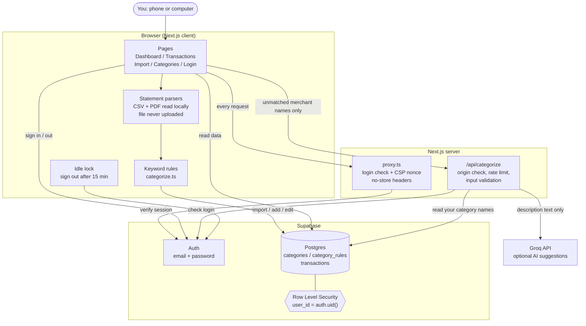
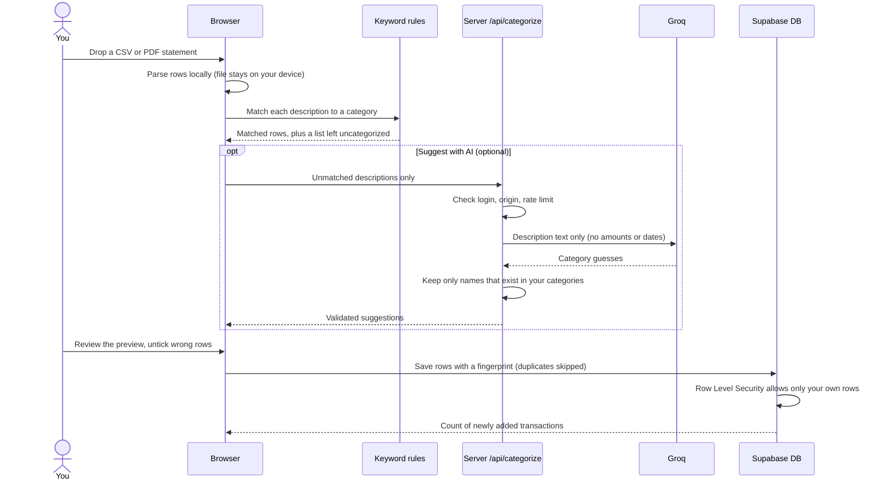

# Expense Tracker

> **For personal use only.** This is a private tool built to track one person's own expenses. It is not a product, it has no support, and it is not meant to be offered to other people or to handle anyone else's financial data.

A private expense tracker. Import statements from your bank or PhonePe (CSV or PDF), add cash expenses by hand, and see your spending sorted into categories. It runs on a dark, SpaceX-style screen that works on both a phone and a computer.

## What it does

- **Dashboard:** monthly spent, income and net, a donut chart by category, a 6-month trend and recent transactions.
- **Transactions:** search and filter, change a category inline, edit, delete, and export to CSV.
- **Import:** upload a bank CSV or a PhonePe PDF, check the preview, untick wrong rows, then import. Importing the same file twice adds nothing new.
- **Categories:** your groups and keyword rules. 13 starter categories and common Indian merchants (Swiggy, Zomato, Uber and so on) are added when you sign up.
- **Smart sorting:** keyword rules first. Anything left over can be sorted by AI (Groq), which is optional. When you fix a category, the app offers to remember that merchant.

## Built with

Next.js 16, React, TypeScript, Tailwind CSS, Supabase (Postgres and login), Recharts, and the D-DIN font (SIL Open Font License, see `src/app/fonts/LICENSE.txt`). Groq is optional.

## Set up (about 10 minutes)

1. **Create a Supabase project** at supabase.com. The free plan is enough.
2. **Create the tables.** In the project open **SQL Editor**, paste all of `supabase/schema.sql`, and run it once.
3. **Add your keys.** Copy `.env.example` to `.env.local` and fill in:
   - `NEXT_PUBLIC_SUPABASE_URL`: Project Settings, API
   - `NEXT_PUBLIC_SUPABASE_ANON_KEY`: the publishable (or anon) key from the same page
   - `GROQ_API_KEY`: optional, from console.groq.com. Leave empty to skip AI suggestions.
4. **Run it:**
   ```
   npm install
   npm run dev
   ```
   Open http://localhost:3000 and create your account.
5. **Lock it down.** Once your own account exists, go to Supabase, Authentication, Sign In / Providers, and turn off **Allow new users to sign up**. Then nobody else can register.

Never use or share the Supabase **secret** or **service_role** key. This app does not need it.

## Getting your statements

- **Bank (best):** in net banking open Account Statement and download as CSV. It covers every UPI app in one file.
- **PhonePe:** History, then the statement download option, pick dates, and save the PDF.
- **Google Pay:** use your bank statement, or request your data from Google Takeout.

**Locked PDFs:** if a statement is password protected, the app asks for the password and opens it in your browser. The password is only used to open the file. It is never sent anywhere or saved. Banks often use your date of birth or the last digits of your phone or account number.

PDF reading is best effort because layouts change. The preview lets you untick wrong rows before saving.

## Architecture



### Import flow



## How your data is protected

- **Row Level Security:** the database itself only returns rows that belong to the signed-in user, even if the app had a bug.
- **Login required everywhere:** `src/proxy.ts` checks the login with Supabase on every request. Signed-out visitors go to `/login`, and the API answers 401.
- **Secrets stay on the server:** the Groq key is only read in `src/app/api/categorize/route.ts`. The publishable Supabase key in the browser is designed to be public and is limited by Row Level Security.
- **AI privacy:** only short merchant descriptions are sent to Groq, never amounts, dates or account numbers. The reply is checked against your own category names before it is used.
- **Strict script policy:** a Content Security Policy where every script needs a one-time code made fresh for each request, so injected scripts cannot run. Also no framing, no MIME sniffing, HSTS and same-origin isolation.
- **Nothing is cached:** signed-in pages and API answers are sent with `no-store`, so the browser and shared devices do not keep your data.
- **Auto sign-out:** after 15 minutes without touching the app, or on coming back to it after that long, you are signed out.
- **Login slow-down:** after 4 wrong passwords the form makes you wait, and the wait grows each time. Supabase also limits attempts on its side.
- **Safe input:** forms are validated, text from files is cleaned, statement files are read in your browser and never uploaded, and exported CSVs are protected against spreadsheet formula injection.

## Keep your data out of version control

`.gitignore` already excludes `.env.local`, build output, and any `.csv` files, because statements and exports hold your real transactions. Never commit a statement, a screenshot of your data, or a key.

## Putting it online (optional)

Import the folder into Vercel, add the same three environment variables, and deploy. Then in Supabase, Authentication, URL Configuration, set the Site URL to your Vercel address. Keep new sign-ups switched off.

## Commands

| Command | What it does |
|---|---|
| `npm run dev` | Start locally |
| `npm run build` | Production build |
| `npm start` | Run the production build |
| `npm test` | Run the tests |
| `npm run lint` | Type-check |

## Project layout

```
src/app/            pages: dashboard, transactions, import, categories, login, and the AI route
src/components/     shared screens and pieces (shell, forms, charts, data provider)
src/lib/            parsers, categorizing, formatting, Supabase clients, security helpers
src/proxy.ts        login check and security headers on every request
supabase/schema.sql database tables, security rules, starter categories
tests/              unit tests for parsers and helpers
```

## Licence and use

Personal use only. Not for resale, hosting for others, or handling anyone else's financial data. Third-party pieces keep their own licences, including D-DIN under the SIL Open Font License.
